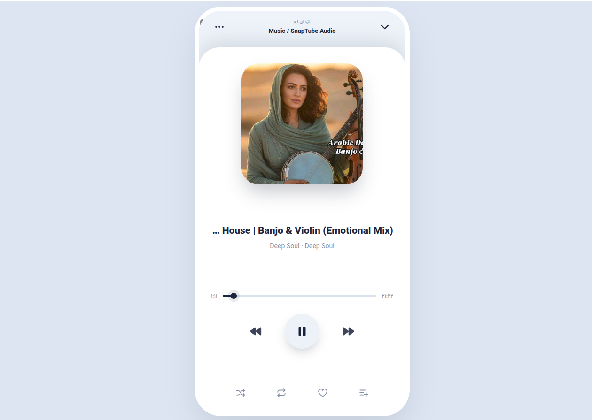

<div dir="rtl" align="right">

<p align="center">
  
</p>

<h1 align="center">میوزیک پلەیەر </h1>

<p align="center">
  میوزیک پلەیەر PWA بە زمانی کوردی سۆرانی — بۆ ئایفۆن و  ئەندرۆید و هەموو ئامێرەکان<br>
  دیزاین: <b>کورد لینوکس <sub>(قەزوان)</sub></b> · <a href="https://www.linux.krd">www.linux.krd</a>
</p>




---

## دەربارە

**لێدەری مۆسیقا** بەرنامەیەکی وێبی (PWA) ـە بۆ لێدانی مۆسیقاکانی خۆت. بوخچە یان فایلەکانی مۆسیقا لە مۆبایلەکەت هەڵدەبژێریت، لەناو بەرنامەکە هەڵدەگیرێن و **بەبێ ئینتەرنێت** لێدەدرێن. بەرنامەکە وەک ئەپێکی ئاسایی لەسەر شاشەی ماڵەوەی ئایفۆن دادەمەزرێت. بە یارمەتی زیرەکی دەستکردی کڵاود دامەزراوە

### تایبەتمەندییەکان

- 📁 **زیادکردنی بوخچە و فایل** — بوخچەیەکی تەواو (لەگەڵ ژێر‌بوخچەکان) یان چەند فایلێک هەڵبژێرە
- 🖼️ **کاڤەری ناو فایل** — وێنەی کاڤەری ناو فایلی MP3 پیشان دەدرێت؛ ئەگەر نەبوو، کاڤەرێکی ڕەنگاوڕەنگ دروست دەکرێت
- ❤️ **دڵخوازەکان** و 📃 **لیستی لێدانی دڵخواز** — دروستکردن، ناوگۆڕین و سڕینەوە
- 🔀 **هەڕەمەکی** و 🔁 **دووبارەکردنەوە** (هەموو / یەک گۆرانی)
- 🧩 **سێ شێوازی پیشاندان** — لیست، تۆڕ و چوارچێوە
- 🎨 **سێ ڕووکار** — ڕۆژ، شەو و ڕەنگی کا
- 👆 **جوڵەی پەنجە** — بۆ گۆڕینی لاپەڕە پەنجە بە لای ڕاست و چەپدا ببە؛ بۆ داخستنی لێدەر بەرەو خوارەوە
- ✨ **ئانیمەیشن** لە نێوان لاپەڕەکان
- 🔒 کۆنتڕۆڵی لێدان لەسەر شاشەی قوفڵ (Media Session) و لێدان لە پاشبنەما
- 🔤 فۆنتی **وەزیرمتن** و ژمارە کوردییەکان (٠١٢٣٤٥٦٧٨٩)
- 📅 ڕێکەوتی زایینی بە مانگە کوردییەکان

---

## دامەزراندن

### ١. دامەزراندن لەسەر ئایفۆن

1. ناونیشانی سایتەکە لە **Safari** بکەرەوە.
2. دوگمەی **Share** (چوارگۆشەی ئاراستە بەرەو سەر) دابگرە.
3. **Add to Home Screen** هەڵبژێرە.
4. **Add** دابگرە — ئایکۆنی بەرنامەکە لەسەر شاشەی ماڵەوە دەردەکەوێت.

### ٢. تاقیکردنەوە لە کۆمپیوتەر

```bash
cd music
python3 -m http.server 8000
# پاشان بکەرەوە: http://localhost:8000
```

---

## چۆنیەتی بەکارهێنان

1. لەسەر دوگمەی **＋** (سەرەوە) دابگرە.
2. **هەڵبژاردنی بوخچە** یان **هەڵبژاردنی فایلەکانی مۆسیقا** هەڵبژێرە و لە «Files»ـی مۆبایلەکەت مۆسیقاکان دیاری بکە.
3. لە لاپەڕەی ماڵەوە بەشەکان بەکاربهێنە: هەموو گۆرانییەکان، بوخچەکان، لیستەکانی لێدان و دڵخوازەکان.
4. لەسەر **⋯**ـی هەر گۆرانییەک دابگرە بۆ زیادکردن بۆ دڵخوازەکان یان لیستی لێدان.
5. لەسەر لێدەری خوارەوە دابگرە بۆ کردنەوەی لاپەڕەی تەواوی لێدان.

---

## تێبینی گرنگ

- **ئایفۆن ڕێگە نادات بەرنامەی وێب خۆکارانە بەدوای مۆسیقادا بگەڕێت.** دەبێت خۆت بوخچە یان فایلەکان لە «Files» هەڵبژێریت.
- دەنگ **لە ناو بەرنامەکەوە ناگۆڕدرێت** (سنووردارییەکی iOS ـە) — دوگمەکانی لای ئایفۆن بەکاربهێنە.
- فۆرماتەکانی **MP3 و M4A** لەسەر ئایفۆن بێ کێشە لێدەدرێن؛ FLAC و هەندێک فۆرماتی تر لەوانەیە لێنەدرێن.
- مۆسیقاکان لە شوێنی هەڵگرتنی سافاری (IndexedDB) هەڵدەگیرێن. ئەگەر داتای سافاری بسڕیتەوە، دەبێت دووبارە زیادیان بکەیتەوە.
- کاڤەری ناو فایل تەنها بۆ فایلەکانی **MP3 (ID3v2.3/2.4)** دەخوێندرێتەوە.
- دوای نوێکردنەوەی فایلەکان، بەرنامەکە بە تەواوی دابخە و دووبارە بیکەرەوە.

---

## پێکهاتەی پڕۆژە

```
music/
├── index.html            ڕووخساری سەرەکی
├── style.css             ستایل و ڕووکارەکان
├── app.js                لۆژیکی بەرنامە (لێدان، لیست، هەڵگرتن …)
├── sw.js                 Service Worker (کارکردن بەبێ ئینتەرنێت)
├── manifest.webmanifest  زانیاری PWA
├── logo.png              لۆگۆ
├── icon-180/192/512.png  ئایکۆنەکان
├── icon.svg
└── fonts/
    ├── Vazirmatn.woff2   فۆنتی وەزیرمتن
    └── OFL.txt           مۆڵەتی فۆنت
```

## تەکنەلۆجیا

HTML · CSS · JavaScript (بێ کتێبخانەی دەرەکی) · IndexedDB · Service Worker · Media Session API

## مۆڵەت

- فۆنتی **Vazirmatn** لەژێر مۆڵەتی [SIL Open Font License 1.1](https://openfontlicense.org) ـە (بڕوانە `fonts/OFL.txt`).
- مافی دیزاین و لۆگۆ: **کورد لینوکس (قەزوان)** — [www.linux.krd](https://www.linux.krd)

</div>
